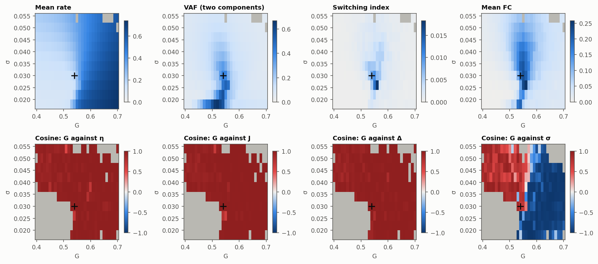

# tvb-error-analysis

An error analysis of a whole-brain model fit in The Virtual Brain (TVB): how far do the fitted numbers depend on things other than what they are named for? Worked through on one paper, Fousek et al. (2024), *Symmetry breaking organizes the brain's resting state manifold* (Scientific Reports).

**Status:** work in progress. Nothing here is peer reviewed, and the essays are drafts.

## The question

The paper fits a whole-brain network model to resting-state data by tuning two parameters, the coupling strength *G* and the noise level *σ*, until summary statistics of the simulated activity look like the data.

This repository asks: **can those statistics tell the model's parameters apart?** If a small change in another parameter does the same thing to the statistics as a change in *G*, then a fitted *G* is not a measurement of coupling. It is one coordinate on a ridge of settings that all fit equally well.

## Findings so far



*Top: four summary statistics over (G, σ). Bottom: how closely the effect of G lines up with the effect of another parameter (+1 = indistinguishable). Cross: the paper's working point.*

- **G is not separable from the node parameters.** Across the transition region, changing *G*, *η*, *J* or *Δ* moves seven summary statistics in the same direction, to within the noise of the runs. One grid step of *G* (0.01) does what a 0.23% change in *η*, a 0.16% change in *J* or a 1% change in *Δ* does.
- **Noise is the one separate dial.** The statistics do see *σ* independently of *G*.
- **The integration step matters.** Halving the step raises the mean firing rate each time, from a step of 0.02 down to 0.0025, in The Virtual Brain itself.

The full write-up, with per-run distributions and standard errors, is a five-page PDF: [`doc/sweep_writeup.pdf`](doc/sweep_writeup.pdf).

**Caveats.** The model settings come from the authors' group's public companion code; that the paper used exactly these is an inference. The maps use four runs per setting. Per-region statistics, and the paper's own "fluidity" statistic, have not been analysed yet.

## Layout

The layout follows Wilson et al. (2017), *Good enough practices in scientific computing*.

| Folder | Contents |
|---|---|
| `src/` | All simulation and analysis code. [`src/README.md`](src/README.md) lists which script belongs to which study. `src/mprjax.py` is a JAX version of The Virtual Brain's Montbrió–Pazó–Roxin kernel: it matches TVB to 2 × 10⁻¹² over 3,000 steps and runs about 40 times faster per run on a GPU. |
| `data/` | Input connectomes. |
| `results/` | Generated output: per-run statistics (`runs/`), figures and tables. |
| `doc/` | The sweep write-up (PDF), essay drafts of a critique of the paper (`essay/`; `essay/v3/` is the most recent full draft), and the dated working log (`LOG.md`, long and unpolished). |
| `external/` | Unmodified copies of third-party code and data, each under its own licence. |

## Rebuilding the results

The per-run statistics are in the repository, so every figure, table and the write-up can be rebuilt without running a simulation. This needs Python 3 with NumPy and Matplotlib (`pip install -r requirements.txt`) and `pdflatex`.

```sh
./src/runall.sh
```

Running the simulations themselves needs JAX with a GPU (`src/mprjax_run.py`) and, for the reference runs, The Virtual Brain 2.10.0 (`src/tvb_ref_run.py`); versions are listed in `requirements.txt`. The raw simulation output (about 1.5 GB) is not included.

## Reference

Fousek, J., Rabuffo, G., Gudibanda, K., Sheheitli, H., Petkoski, S. & Jirsa, V. Symmetry breaking organizes the brain's resting state manifold. *Scientific Reports* **14**, 31970 (2024). [doi:10.1038/s41598-024-83542-w](https://doi.org/10.1038/s41598-024-83542-w)
